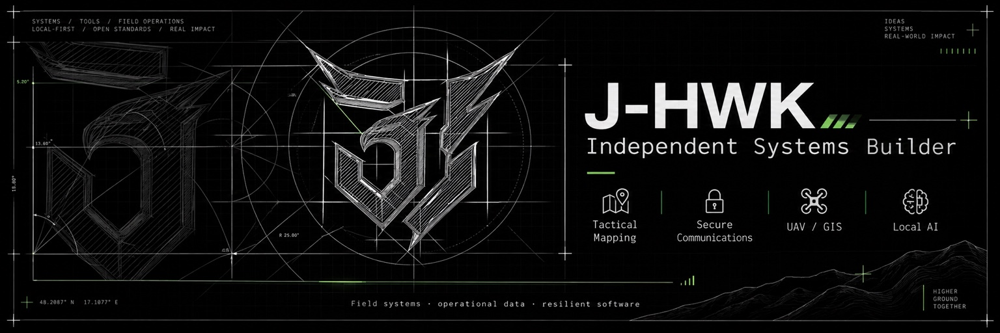
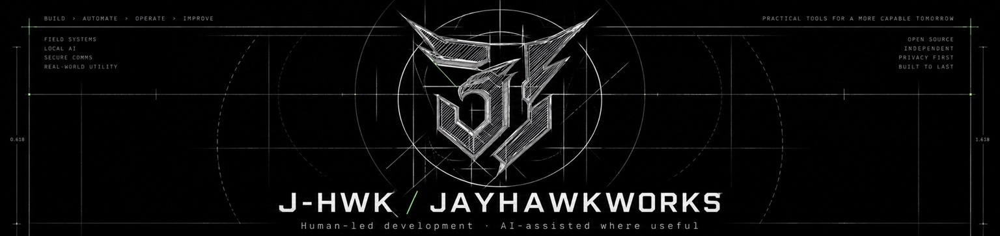
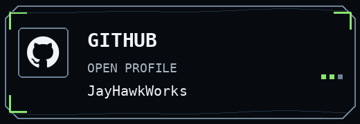
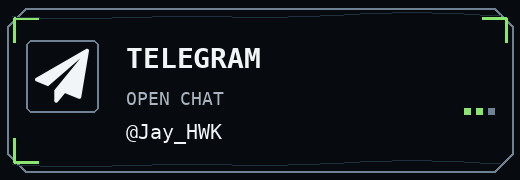

<a href="#identity">IDENTITY</a> · <a href="#development">DEVELOPMENT</a> · <a href="#principles">PRINCIPLES</a> · <a href="#approach">APPROACH</a> · <a href="#background">BACKGROUND</a> · <a href="#contact">CONTACT</a>

<strong>🇬🇧 EN</strong> / <a href="./README.sk.md">🇸🇰 SK</a>

## Identity & Introduction

**J-HWK / JayHawkWorks — Independent Systems Builder**

I design and explore field-oriented software, geospatial systems, communications technologies and dependable local tools. My priority is practical usefulness: clear information, understandable interfaces and responsible operation.

**Human-led development. AI-assisted where useful.**

## Technical Projects & Development Areas

The following areas represent a selection of my technical work and development interests. Individual project names and implementation details remain private.

### 01 / UAV & Aerial Reconnaissance Technologies

Software-oriented work around unmanned aerial systems, aerial observation and geospatial applications. The focus is on useful information, practical field applications and responsible interpretation of observations.

### 02 / Geospatial & Field Mapping Systems

Mapping and geospatial applications concerned with geographic information, clear presentation and usability in real working environments.

### 03 / Communications & Signal Technologies

Exploration of communications software and signal-related systems, with an emphasis on coordination, information clarity and dependable operation.

### 04 / Operational Management Systems

Software for organizing information, resources and structured workflows, designed with everyday usability and clear presentation in mind.

### 05 / Local AI & Intelligent Automation

Research and development around local AI, controlled automation and assistance for practical tasks, with attention to privacy and human oversight.

### 06 / Systems Engineering & Technical Integration

Integration of software, data and local technical environments, guided by maintainability, clear responsibilities and real-world requirements.

**Beyond this overview**

The areas highlighted above represent only a selection of my work. I have also worked on other software, hardware and field-oriented projects that are not individually documented here.

Over time, I plan to share selected new projects, practical tools, technical resources and informational repositories that may be useful to others. Some development work will remain private.

## Engineering Principles

A useful system should be understandable before it is complex. Across different development areas, I value:

- **Clarity:** show relevant information without unnecessary noise.
- **Trust:** acknowledge data quality, uncertainty and limitations.
- **Control:** use deliberate permissions and reviewable actions.
- **Resilience:** account for changing conditions and interrupted work.
- **Maintainability:** prefer understandable designs over avoidable complexity.

These principles describe an engineering approach, not the architecture of any private project.

## Development Approach

1. Understand the real task and its context.
2. Define what the user needs to know and do.
3. Design a practical, clear interface.
4. Develop and review the system deliberately.
5. Test limitations, failures and recovery.
6. Refine for reliability and long-term usefulness.

I use AI-assisted tools where they provide measurable value. Important decisions, privacy boundaries and final technical review remain human responsibilities.

## Technical Background

My experience and interests span **UAV operation, geospatial tools, radio communications, local computing, networking, automation and hardware/software integration**.

Practical field work informs my preference for systems that stay clear and dependable outside ideal conditions. Private deployments, operating parameters and sensitive project details are not published.

## Contact & Connect

Choose GitHub, Proton Mail or Telegram. Use **SAVE CONTACT** to open or download the J-HWK digital contact card.

Local time: <strong>Europe/Bratislava</strong> · CET (UTC+01:00) / CEST (UTC+02:00)

