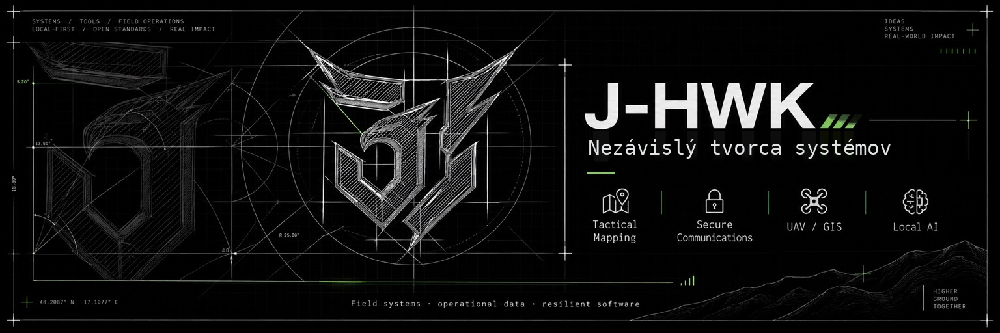
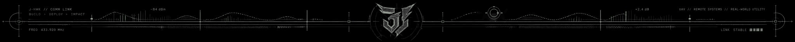
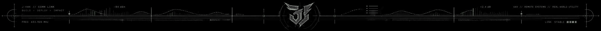
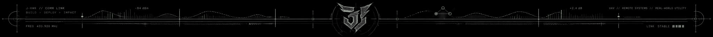
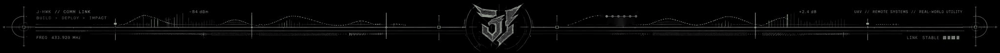
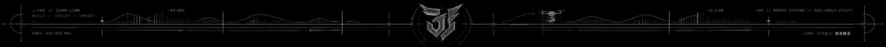
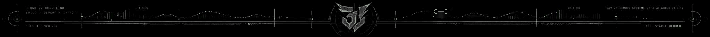
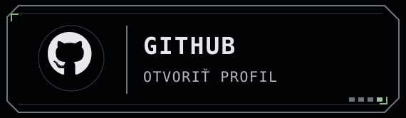
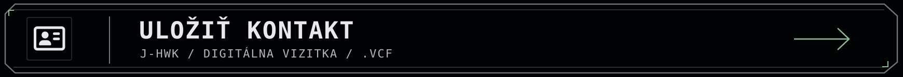
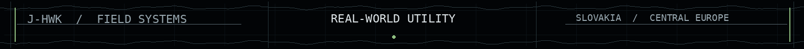

<a href="#identita">IDENTITA</a> · <a href="#vyvoj">VÝVOJ</a> · <a href="#principy">PRINCÍPY</a> · <a href="#postup">POSTUP</a> · <a href="#skusenosti">SKÚSENOSTI</a> · <a href="#kontakt">KONTAKT</a>

<a href="./README.md">🇬🇧 EN</a> / <strong>🇸🇰 SK</strong>

## Identita a predstavenie

**J-HWK / JayHawkWorks — Nezávislý tvorca technických systémov**

Navrhujem a skúmam terénny softvér, geopriestorové systémy, komunikačné technológie a spoľahlivé lokálne nástroje. Prioritou je praktický úžitok: prehľadné informácie, zrozumiteľné rozhrania a zodpovedná prevádzka.

**Vývoj pod vedením človeka. AI ako pomocný nástroj tam, kde je užitočná.**

## Technické projekty a oblasti vývoja

Nasledujúce oblasti predstavujú výber mojej technickej práce a vývojových záujmov. Názvy jednotlivých projektov a podrobnosti realizácie zostávajú súkromné.

### 01 / UAV a technológie leteckého prieskumu

Softvérová práca v oblasti bezpilotných leteckých systémov, leteckého pozorovania a geopriestorových aplikácií. Dôraz kladiem na použiteľné informácie, praktické terénne využitie a zodpovedné vyhodnocovanie pozorovaní.

### 02 / Geopriestorové a terénne mapové systémy

Mapové a geopriestorové aplikácie zamerané na geografické informácie, prehľadnú prezentáciu a použiteľnosť v reálnych pracovných podmienkach.

### 03 / Komunikačné a signálové technológie

Skúmanie komunikačného softvéru a systémov súvisiacich so signálmi, s dôrazom na koordináciu, zrozumiteľné informácie a spoľahlivú prevádzku.

### 04 / Prevádzkové a manažérske systémy

Softvér na organizáciu informácií, zdrojov a štruktúrovaných pracovných postupov navrhovaný s ohľadom na každodennú použiteľnosť a prehľadnosť.

### 05 / Lokálna AI a inteligentná automatizácia

Výskum a vývoj v oblasti lokálnej AI, kontrolovanej automatizácie a asistencie pri praktických úlohách, s ohľadom na súkromie a ľudský dohľad.

### 06 / Systémové inžinierstvo a technická integrácia

Prepojenie softvéru, dát a lokálnych technických prostredí so zameraním na udržiavateľnosť, jasné zodpovednosti a reálne požiadavky.

**Ďalšie projekty a budúci vývoj**

Uvedené oblasti predstavujú iba výber mojej práce. Pracoval som aj na ďalších softvérových, hardvérových a terénnych projektoch, ktoré tu jednotlivo nerozpisujem.

Postupne plánujem zverejňovať vybrané nové projekty, praktické nástroje, technické materiály a informačné repozitáre, ktoré môžu byť užitočné aj ostatným. Časť vývojovej práce zostane súkromná.

## Inžinierske princípy

Užitočný systém má byť predovšetkým zrozumiteľný. Naprieč oblasťami vývoja považujem za dôležité:

- **Prehľadnosť:** zobrazovať podstatné informácie bez zbytočného šumu.
- **Dôveryhodnosť:** priznávať kvalitu dát, neistotu a obmedzenia.
- **Kontrolu:** používať primerané oprávnenia a kontrolovateľné úkony.
- **Odolnosť:** počítať s meniacimi sa podmienkami a prerušenou prácou.
- **Udržiavateľnosť:** uprednostňovať pochopiteľný návrh pred zbytočnou zložitosťou.

Ide o zásady práce, nie o opis architektúry súkromných projektov.

## Postup návrhu a vývoja

1. Porozumieť skutočnej úlohe a jej kontextu.
2. Určiť, čo používateľ potrebuje vedieť a vykonať.
3. Navrhnúť praktické a prehľadné rozhranie.
4. Vyvíjať a kontrolovať systém premyslene.
5. Testovať obmedzenia, zlyhania a obnovu.
6. Zlepšovať spoľahlivosť a dlhodobú použiteľnosť.

AI nástroje využívam tam, kde prinášajú merateľný prínos. Dôležité rozhodnutia, ochrana súkromia a konečná technická kontrola zostávajú v rukách človeka.

## Technické skúsenosti

Moje skúsenosti a záujmy zahŕňajú **prevádzku UAV, geopriestorové nástroje, rádiovú komunikáciu, lokálne systémy, siete, automatizáciu a prepájanie hardvéru so softvérom**.

Praktické skúsenosti z terénu ovplyvňujú môj dôraz na prehľadné a spoľahlivé riešenia aj mimo ideálnych podmienok. Súkromné nasadenia, prevádzkové parametre a citlivé podrobnosti projektov nezverejňujem.

## Kontakt a spojenie

Vyber GitHub, Proton Mail alebo Telegram. Pomocou panelu **ULOŽIŤ KONTAKT** si môžeš uložiť digitálnu vizitku J-HWK.

Miestny čas: <strong>Europe/Bratislava</strong> · CET (UTC+01:00) / CEST (UTC+02:00)

